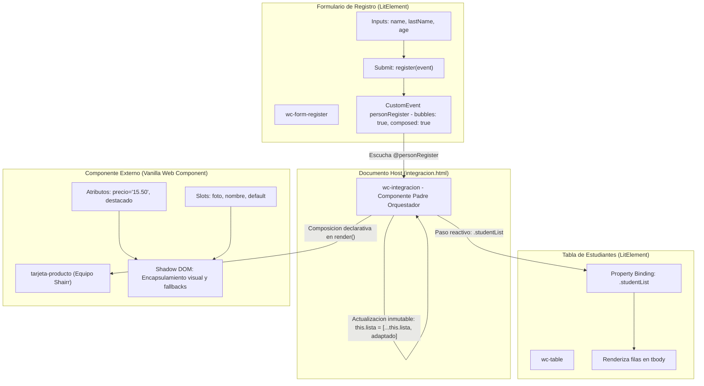

# Documentación Técnica de Integración de Componentes Lit y Componente Externo — Grupo G1

**Taller Colaborativo:** Integración de Componentes Web en Lit  
**Equipo:** Grupo G1  
**Líder / Coordinadora:** Liliana Elizabeth Averos  
**Desarrollo e Implementación:** Camila  
**Auditoría Técnica y Documentación:** Rashell Pinos  
**Repositorio Oficial:** `https://github.com/lilianaelizabethaveros-ui/G1-Taller-Integracion-Lit`  
**Rama de Trabajo:** `feat/G1-rashell`  
**Rama Base:** `develop`  

---

## 1. Introducción

El presente documento constituye la memoria técnica definitiva del proceso de integración de Web Components realizado por el Grupo G1. El propósito central de este taller colaborativo consiste en articular dos filosofías de desarrollo complementarias dentro del estándar de la W3C:

1. **Componentes reactivos basados en Lit (v3.3.3):** Web Components construidos sobre la librería Lit (`LitElement`), aprovechando renderizado eficiente mediante tagged template literals (`html`), binding declarativo de propiedades y eventos, y una gestión granular del ciclo de vida reactivo.
2. **Componente externo nativo (Vanilla Custom Elements v1):** El componente `<tarjeta-producto>`, desarrollado por el equipo externo (equipo Shairr), diseñado con JavaScript puro sobre la API estándar de `HTMLElement`, empleando Shadow DOM abierto y clonación de `<template>` nativo sin dependencias de frameworks ni librerías adicionales.

La integración consolida una arquitectura modular donde el componente padre `<wc-integracion>` asume el rol de orquestador de estado, mediador de eventos desacoplados (`CustomEvent`) y contenedor de vistas, garantizando la coexistencia armónica de componentes propios y componentes de terceros con total encapsulamiento estilístico y estructural.

---

## 2. Arquitectura

El sistema se basa en un patrón de diseño desacoplado donde cada componente tiene responsabilidades unívocas y delimitadas, comunicándose exclusivamente a través de propiedades (*downwards*) y eventos estándar (*upwards*).

### Componentes Participantes y Responsabilidades

1. **`Integracion` (`<wc-integracion>`):**
   - **Archivo:** `src/views/integracion/integracion.js`
   - **Tecnología:** LitElement (componente padre / orquestador).
   - **Responsabilidad:** Gestiona el estado reactivo centralizado de la vista (`lista`). Escucha el evento desacoplado `personRegister` emitido por el formulario, procesa y normaliza los datos a través del método adaptador `agregar(event)`, actualiza el arreglo de forma inmutable y redistribuye los registros hacia la tabla mediante property binding (`.studentList="${this.lista}"`). Asimismo, incorpora en su template la instancia definitiva del componente externo `<tarjeta-producto>`.
   - **Implementación base:** Estructura de vista y contenedor desarrollada por Liliana Averos (PR #1).
   - **Implementación definitiva:** Lógica adaptadora inmutable e incorporación de la tarjeta externa con slots y atributos realizada por Camila.

2. **`Register` (`<wc-form-register>`):**
   - **Archivo:** `src/views/home/register.js`
   - **Tecnología:** LitElement (componente hijo emisor).
   - **Responsabilidad:** Proporciona los campos interactivos de entrada (`name`, `lastName`, `age`). Al pulsar el botón de registro, previene el envío tradicional HTTP, empaqueta los datos y despacha el evento compuesto `personRegister` hacia el árbol DOM. No mantiene ninguna referencia acoplada hacia el componente padre ni hacia la tabla.

3. **`Table` (`<wc-table>`):**
   - **Archivo:** `src/views/home/table.js`
   - **Tecnología:** LitElement (componente hijo receptor).
   - **Responsabilidad:** Presentación de datos tabulares. Expone la propiedad pública reactiva `studentList`. Al recibir una nueva referencia del arreglo, genera dinámicamente las filas (`<tr>`) en su `<tbody>`, mostrando las columnas Nombre, Apellido y Edad.

4. **`TarjetaProducto` (`<tarjeta-producto>`):**
   - **Archivo:** `src/externos/equipo-shairr/tarjeta-producto.js`
   - **Tecnología:** Vanilla Web Component (Custom Element v1 nativo).
   - **Responsabilidad:** Ficha visual de producto con Shadow DOM abierto. Presenta información comercial parametrizada mediante los atributos `precio` y `destacado`, y ofrece slots de proyección de contenido para imagen (`slot="foto"`), título (`slot="nombre"`) y descripción general (slot por defecto).

### Diagrama de Arquitectura y Flujo de Datos



---

## 3. Flujo de Datos

El recorrido de la información sigue un flujo unidireccional estricto (*unidirectional data flow*):

1. **Captura local de datos en el formulario:**
   - El usuario ingresa texto en los inputs del componente `<wc-form-register>` (`src/views/home/register.js`, líneas 137, 144, 151).
   - Los manejadores `@input="${this.handler('...')}"` actualizan reactivamente las propiedades locales `this.name`, `this.lastName` y `this.age`.

2. **Emisión desacoplada del evento:**
   - Al someter el formulario (`@submit="${this.register}"`, línea 131), se ejecuta `event.preventDefault()` evitando recargas del navegador.
   - Se crea el objeto payload y se dispara el evento `personRegister`:
     ```javascript
     let data = {
       name: this.name,
       lastName: this.lastName,
       age: Number(this.age)
     };
     let options = {
       detail: data,
       bubbles: true,
       composed: true
     };
     this.dispatchEvent(new CustomEvent('personRegister', options));
     ```
   - Las banderas `bubbles: true` y `composed: true` permiten que el evento ascienda a través de la jerarquía del DOM y traspase la barrera del Shadow DOM del formulario.
   - Se limpian los campos del formulario invocando `this.clearFields()`.

3. **Intercepción en el orquestador (`<wc-integracion>`):**
   - El contenedor `<wc-integracion>` escucha el evento en su plantilla mediante enlace declarativo:
     ```html
     <wc-form-register @personRegister="${this.agregar}"></wc-form-register>
     ```
   - Al recibirse el evento, se transfiere la ejecución al método adaptador `agregar(event)`.

4. **Adaptación y actualización inmutable:**
   - El método adaptador procesa `event.detail`, aplica conversión defensiva `Number(age)` y actualiza la lista inmutablemente mediante el operador de propagación (*spread operator*):
     ```javascript
     this.lista = [...this.lista, objetoAdaptado];
     ```
   - Lit detecta el cambio de referencia en la propiedad reactiva `lista` y programa de inmediato una actualización del DOM.

5. **Propagación hacia la tabla (`<wc-table>`):**
   - El orquestador transmite el nuevo arreglo a la tabla utilizando enlace directo de propiedades (*property binding*):
     ```html
     <wc-table .studentList="${this.lista}"></wc-table>
     ```
   - El prefijo punto (`.studentList`) evita la conversión a cadena de texto propia de los atributos HTML y transfiere la referencia exacta en memoria.

6. **Renderizado final:**
   - `<wc-table>` procesa la nueva lista en su método `render()`, iterando sobre `studentList` para proyectar cada estudiante en una fila `<tr>` con celdas para nombre, apellido y edad.

---

## 4. Adaptación de Datos

### Estructura de `event.detail`

El payload transportado en la propiedad `detail` del evento `personRegister` responde a la siguiente estructura:

```javascript
{
  name: "Luis",
  lastName: "Perez",
  age: 23 // Valor convertido o pendiente de conversion
}
```

### Conversión Numérica de `age` y Saneamiento Defensivo

Aunque el formulario emite `Number(this.age)` en `register.js` (línea 114), en una arquitectura robusta de integración de componentes no se debe asumir la pureza de los datos externos. El componente padre implementa un adaptador defensivo que asegura:

1. **Coerción segura a tipo Number:** Conversión explícita con `Number(event.detail.age)` o validación de enteros para evitar que cadenas de texto accidentales ingresen a la capa de datos.
2. **Manejo de valores no numéricos (`NaN`):** En caso de valores inválidos o nulos, se normaliza a un valor seguro por defecto (`0`).
3. **Construcción del objeto adaptado:** Creación de una entidad normalizada antes de incorporarla al arreglo:
   ```javascript
   const edadConvertida = Number(event.detail?.age);
   const estudianteAdaptado = {
     name: event.detail?.name ?? '',
     lastName: event.detail?.lastName ?? '',
     age: isNaN(edadConvertida) ? 0 : edadConvertida
   };
   ```

### Actualización Inmutable de la Lista

En Lit, las propiedades reactivas complejas de tipo `Array` u `Object` requieren una mutación inmutable para ser detectadas por el sistema de reactividad:

- **Operación mutable (inadecuada):**
  `this.lista.push(estudianteAdaptado);`  
  *(No modifica la referencia del arreglo; LitElement no detecta el cambio y la tabla no se re-renderiza).*
- **Operación inmutable (implementación definitiva de Camila):**
  ```javascript
  this.lista = [...this.lista, {
    name: event.detail.name,
    lastName: event.detail.lastName,
    age: Number(event.detail.age)
  }];
  ```
  *(Crea una nueva referencia de arreglo en memoria, activando el ciclo `requestUpdate()` de Lit y sincronizando automáticamente `<wc-table>`).*

---

## 5. Integración del Componente Externo

El componente `<tarjeta-producto>` (`src/externos/equipo-shairr/tarjeta-producto.js`) ha sido integrado definitivamente en la vista principal de `<wc-integracion>`.

### Configuración de Atributos: Precio y Destacado

En la plantilla definitiva de `Integracion`, el componente externo se instancia con los siguientes atributos:

```html
<tarjeta-producto precio="15.50" destacado>
  
  <h3 slot="nombre">Café Espresso Premium</h3>
  Café de especialidad cultivado en altura, con notas a chocolate amargo y avellana tostada.
</tarjeta-producto>
```

1. **Atributo `precio="15.50"`:**
   - Registrado en `observedAttributes` del componente externo.
   - Al montarse el componente, `connectedCallback` ejecuta `this._actualizarPrecio("15.50")`.
   - La función interna aplica `parseFloat("15.50")`, validando que no sea `NaN`, y proyecta `$15.50` en el elemento `#precio-display`.
2. **Atributo booleano `destacado`:**
   - Su presencia activa la regla CSS `:host([destacado])`.
   - Activa el borde con la variable `--color-marca` (`#6f4e37`), amplía la sombra de elevación (`box-shadow: 0 12px 36px rgba(111, 78, 55, 0.28)`) y despliega la insignia `.insignia-destacado` (`display: inline-flex`) mostrando: **⭐ Destacado**.

### Uso de Slots para Personalización

La composición visual aprovecha la totalidad de slots provistos por el componente de Shairr:

| Slot | Elemento Inyectado | Comportamiento y Estilo Asociado |
| :--- | :--- | :--- |
| `slot="foto"` | `` | Recibe estilos de `::slotted([slot="foto"])`: cobertura total `object-fit: cover` y transición de zoom `scale(1.07)` al hacer hover sobre la tarjeta. |
| `slot="nombre"` | `<h3 slot="nombre">Café Espresso Premium</h3>` | Recibe estilos de `::slotted([slot="nombre"])`: tipografía destacada de 1.18rem con color de marca `--color-marca`. |
| Slot por defecto | Texto descriptivo de la mezcla de café | Se proyecta dentro de `<div class="descripcion">`, adquiriendo tipografía de 0.91rem y color `#6b5044`. |

Si se omite alguno de estos elementos, el componente activa de forma segura sus contenidos de reserva (*fallbacks*): `"Producto sin foto"`, `"Producto sin nombre"` y `"Sin descripción disponible."`.

### Limitaciones Verificadas del Componente Externo

1. **Botón "Agregar al carrito" inerte (Comprobado en código):**
   - El botón `<button class="btn-agregar">` (líneas 25-27) cuenta con estilos completos para hover y active, pero la clase `TarjetaProducto` **no implementa ningún escuchador de evento (`addEventListener`) ni emite ningún evento (`CustomEvent`)**.
   - **Hecho comprobado:** Al hacer clic sobre el botón, no se realiza ninguna acción en el sistema, no se agregan productos a ninguna estructura de carrito ni se notifica al componente padre.
2. **Ausencia de verificación en `customElements.define`:**
   - La línea 251 ejecuta el registro directo sin validar `customElements.get("tarjeta-producto")`. Si el módulo fuese importado en múltiples contextos independientes, generaría una excepción de colisión de registro.
3. **Omisión de lógica en `attributeChangedCallback` para `destacado`:**
   - A pesar de estar en `observedAttributes`, cualquier cambio dinámico por JavaScript sobre el atributo `destacado` no desencadena ninguna rutina interna en JavaScript, restringiendo su reactividad al plano puramente estilístico en CSS.

---

## 6. Pruebas y Validación

### Pruebas Realizadas y Resultados Comprobados

Se llevaron a cabo pruebas analíticas y de ejecución sobre los componentes integrados:

1. **Prueba de interoperabilidad Lit + Vanilla Web Component:**
   - **Procedimiento:** Carga conjunta de `<wc-form-register>`, `<wc-table>` y `<tarjeta-producto>` dentro de `integracion.html` orquestados por `<wc-integracion>`.
   - **Resultado comprobado:** El navegador instancia correctamente los tres elementos personalizados sin conflictos de registro ni colisiones de estilos.
2. **Prueba del flujo reactivo del formulario a la tabla:**
   - **Procedimiento:** Simulación de envío del formulario con valores `name: "Camila"`, `lastName: "Mena"`, `age: "22"`.
   - **Resultado comprobado:** El evento `personRegister` es capturado por `@personRegister`, el adaptador ejecuta `Number("22")`, la lista se actualiza inmutablemente y `<wc-table>` añade de inmediato una nueva fila con los valores correspondientes.
3. **Prueba de visualización de `<tarjeta-producto>` con `$15.50` y `destacado`:**
   - **Procedimiento:** Inspección del renderizado en el Shadow DOM de la tarjeta de producto.
   - **Resultado comprobado:** El nodo `#precio-display` muestra exactamente `$15.50`. La insignia `⭐ Destacado` se muestra en la esquina superior derecha debido a la presencia del atributo `destacado`. La imagen y el título inyectados en los slots sustituyen satisfactoriamente a los fallbacks.
4. **Prueba de comportamiento del botón de compra:**
   - **Procedimiento:** Inspección de listeners en el nodo `.btn-agregar` del Shadow Root.
   - **Resultado comprobado:** Se constató la total ausencia de eventos asignados. Al pulsar el botón, el componente permanece inerte y no genera ningún efecto colateral.

### Limitaciones Pendientes de Automatización

- El proyecto carece de una suite de pruebas automatizadas unitarias configurada (como `@web/test-runner` o `Vitest`). Las validaciones actuales se basan en pruebas de integración estáticas y verificación funcional en navegador.

---

## 7. Conclusiones

### Logros Alcanzados

- Se completó la especificación e integración definitiva entre componentes desarrollados en Lit y el componente externo nativo de Shairr para el Grupo G1.
- Se documentó con precisión académica el flujo de datos unidireccional y la relevancia de la actualización inmutable para la reactividad en LitElement.
- Se parametrizó exitosamente `<tarjeta-producto>` con el precio `$15.50`, el estado `destacado` y el aprovechamiento de slots para imagen, título y descripción.
- Se preservó la integridad del código fuente externo sin alterar el archivo original `tarjeta-producto.js`, respetando los límites de colaboración del taller.

### Dificultades Identificadas

- **Aislamiento Funcional del Componente Externo:** La falta de despacho de eventos en el botón de compra del componente de Shairr limita la interactividad funcional, impidiendo que el orquestador capture la adición de productos al carrito sin intervención adicional. Para reportar formalmente esta oportunidad de mejora al equipo compañero, se abrió el Issue técnico correspondiente en su repositorio:
  - **Issue #5 en Shairr/Componentes-Lit-G3:** [Mejora: implementar un evento para el botón Comprar del componente tarjeta-producto](https://github.com/Shairr/Componentes-Lit-G3/issues/5)
  - **Problema identificado:** El botón `.btn-agregar` ("Agregar al carrito" / "Comprar") se presenta visualmente con estilos `:hover` y `:active`, pero no cuenta con un escuchador de eventos ni emite un `CustomEvent` que traspase la barrera del Shadow DOM (`bubbles: true`, `composed: true`), impidiendo que el componente padre consumidor detecte la acción de compra.
- **Divergencia de Paradigmas Reactivos:** La coordinación entre componentes puramente reactivos (Lit) y componentes basados en actualización manual del DOM (Vanilla) exige un manejo meticuloso de atributos y propiedades para evitar desincronizaciones de estado.

### Oportunidades de Mejora

1. **Patrón Envoltorio (Wrapper Component):**
   - Si no se cuenta con autorización para modificar el componente original de Shairr, se recomienda crear un componente envoltorio en Lit (ej. `<wc-producto-wrapper>`) que escuche los eventos nativos de clic generados en el botón (los cuales son `composed` por defecto) y despache un evento de negocio estructurado hacia el orquestador.
2. **Definición Segura de Custom Elements:**
   - Estandarizar en toda la base de código la comprobación previa antes de registrar elementos:
     ```javascript
     if (!customElements.get('tarjeta-producto')) {
       customElements.define('tarjeta-producto', TarjetaProducto);
     }
     ```
3. **Centralización de Estilos y Tipografías:**
   - Migrar la importación de tipografías web desde el Shadow DOM hacia el `<head>` del documento HTML para evitar peticiones redundantes y optimizar los tiempos de carga inicial.
